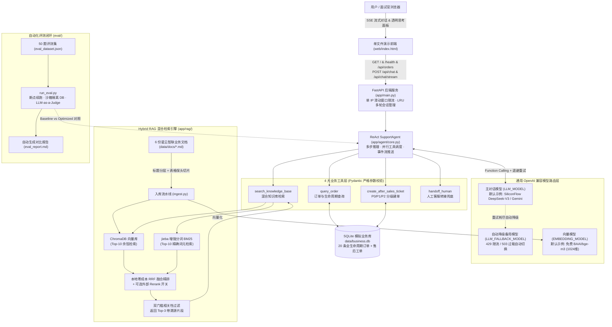

# 星云智联（NebulaLink）企业级智能客服与知识库 Agent 系统

[](https://www.python.org/)
[](https://fastapi.tiangolo.com/)
[](https://www.trychroma.com/)
[](https://platform.openai.com/docs/api-reference)
[](./docker-compose.yml)
[](https://www.modelscope.cn/studios/Kamicake679/nebulalink-support-agent)

面向消费电子品牌 **星云智联（NebulaLink）**（主营 `NL-Pro2026`、`NL-Air3`、`NL-Studio` 三款无线耳机）的**端到端企业级智能客服与知识库 Agent 系统**。

项目完整覆盖 **Hybrid RAG 混合检索 → ReAct Function Calling 业务闭环 → SSE 透明思考可视化交互 → 50 题自动化量化评测 → Docker 容器化交付** 全链路，致力于解决传统客服机器人“查不准、爱编造、只能问答不能办事、绑定单一商业模型”四大核心痛点。

> **🚀 在线体验（Live Demo · 中国大陆免代理直连）**：
> **[https://www.modelscope.cn/studios/Kamicake679/nebulalink-support-agent](https://www.modelscope.cn/studios/Kamicake679/nebulalink-support-agent)**
>
> - 托管于阿里云魔搭创空间（Docker 容器），底层接入硅基流动 `DeepSeek-V3` + 免费 `BAAI/bge-m3`；
> - 页面内置 20 条模拟订单清单与快捷测试按钮，可直接体验 **多轮查单/建单、SSE 实时透明思考面板与知识库引用溯源**；
> - 若长时间无访问进入自动休眠，首次打开等待约 10~20 秒自动唤醒即可使用。

---

## 核心评测成果（50 题全量 Baseline vs Optimized）

> 评测基于 [`data/eval_dataset.json`](data/eval_dataset.json)（50 题，覆盖常规知识库、精准参数条款、复合查单建单、知识库外拒答四大场景），使用 `LLM=deepseek-ai/DeepSeek-V3`、`Embedding=BAAI/bge-m3`、`Rerank=关闭（本地免费 RRF 融合）` 严格同题对照运行。完整分析见 **[`eval/eval_report.md`](eval/eval_report.md)**。

### 总览指标对比

| 评估指标 | 评估方式 | Baseline（纯向量） | Optimized（混合检索 + 防幻觉） | 提升幅度 (Δ) |
| :--- | :--- | :---: | :---: | :---: |
| **检索命中率 (`Hit Rate@3`)** | 规则匹配（Top-3 引用命中 `expected_source`） | 84.2% (32/38) | **89.5% (34/38)** | **+5.3 pp** |
| **回答准确率 (`Accuracy`)** | LLM-as-a-Judge（对比 `ground_truth`） | 90.0% (36/40) | **90.0% (36/40)** | 0.0 pp |
| **工具调用准确率 (`Tool Call Accuracy`)** | 规则匹配（成功调用 `expected_tool`） | 100.0% (40/40) | **100.0% (40/40)** | 0.0 pp |
| **拒答抗幻觉率 (`Refusal Rate`)** | LLM-as-a-Judge（诚实拒答且无幻觉编造） | 90.0% (9/10) | **100.0% (10/10)** | **+10.0 pp** |
| **平均单题耗时 (`Avg Latency`)** | 端到端 Agent 调度耗时 | 19.78s | 22.78s | +3.00s (+15.1%) |
| **P95 响应耗时 (`P95 Latency`)** | 95 分位端到端耗时 | 31.08s | 43.56s | +12.48s (+40.2%) |

### 分题型细分表现

| 题型类别 | 样本数 | Hit@3 (`Base → Opt`) | 准确率 / 拒答率 (`Base → Opt`) | 工具调用率 (`Base → Opt`) | 平均耗时 (`Base → Opt`) |
| :--- | :---: | :---: | :---: | :---: | :---: |
| 常规知识库问答 (`normal_kb`) | 20 | 100.0% → 100.0% | 95.0% → 95.0% | 100.0% → 100.0% | 19.91s → 24.23s |
| 精准参数/数值条款 (`exact_detail`) | 10 | 100.0% → 100.0% | 90.0% → 90.0% | 100.0% → 100.0% | 21.59s → 27.85s |
| 业务工具/复合查单建单 (`tool_call`) | 10 | 25.0% → **50.0%** | 80.0% → 80.0% | 100.0% → 100.0% | 19.04s → 21.16s |
| 知识库外拒答抗幻觉 (`unanswerable`) | 10 | N/A | 90.0% → **100.0%** | N/A | 18.46s → **16.41s** |

---

## 解决的业务痛点与核心设计

| 业务痛点 | 工程级解决方案 |
| :--- | :--- |
| **精确型号与数值条款召回漏检**<br>纯向量检索对 `NL-Pro2026`、`-52dB`、`15%` 折旧费等精确词元不敏感 | **Markdown 结构化切片（超长表格自动保留表头）+ Hybrid RAG**：ChromaDB 语义向量 Top-10 与 `jieba` 增强分词 BM25 Top-10 双路召回，使用本地免费 **RRF 融合精排**（支持按需开启外部 Rerank API）。 |
| **知识库外问题产生幻觉**<br>面对竞品对比、内部机密或未收录政策时强行编造条款 | **双门槛相关性门控 + 强溯源防幻觉 Prompt**：余弦相似度门槛（`0.56`）与 BM25 保底门槛（`5.0` + 语义下限 `0.45`）拦截低相关噪音；强制输出 `[来源: 文件名]`，未命中即诚实拒答并调用 `handoff_human` 转人工，50 题拒答率达 **100.0%**。 |
| **客服“只动口不动手”且易编造订单号**<br>无法联动订单生命周期（未激活/已激活/过保/价保）执行售后建单 | **ReAct 多步推理 + 4 大业务工具 + Pydantic 严格校验**：集成 `search_knowledge_base`、`query_order`、`create_after_sales_ticket`、`handoff_human`；拦截 `UNKNOWN/NULL` 等占位符防止臆造订单号；支持单轮并行工具调用与 SLA 自动分级（P0/P1/P2）。 |
| **黑盒回复不可信 & 演示体验差**<br>用户和运维人员看不到检索命中片段与工具执行参数 | **单文件“透明思考”前端演示台（`web/index.html`）**：通过 `POST /api/chat/stream` SSE 实时推送每一步思考状态、工具入参/出参轨迹、引用溯源卡片与流式打字机回复，并支持一键切换 `Optimized / Baseline` 对照体验。 |
| **模型生态锁定 & 推理成本高**<br>硬编码单一厂商 SDK，遇 429/503 易雪崩 | **通用 OpenAI 兼容协议 + 硅基流动/多模型低成本路由**：LLM 与 Embedding 均走标准 OpenAI 接口，改 `.env` 零代码切平台；内置指数退避重试与 `LLM_FALLBACK_MODEL` 自动降级容灾。 |

---

## 系统架构图



---

## 技术栈与架构亮点

| 模块 | 选型 | 关键说明 |
| :--- | :--- | :--- |
| **Web / API 服务** | FastAPI + Uvicorn + Pydantic v2 | 支持同步 `/api/chat` 与 SSE 流式 `/api/chat/stream`；内置单 IP 滑动窗口限流（20 req/min）与 LRU 会话管理 |
| **LLM 编排与路由** | `openai` Python SDK（通用兼容协议） | 零代码切换 SiliconFlow / Gemini / OpenAI / DeepSeek / 阿里云百炼 / 本地 Ollama；支持主备模型自动降级 |
| **Hybrid RAG** | ChromaDB + `rank_bm25` + `jieba` | Markdown 标题分层切片 + 超长表格保留表头；向量与 BM25 双路召回；默认本地免费 **RRF** 融合（`RERANK_ENABLED` 可开关） |
| **业务数据底座** | 内置 `sqlite3` | 零外部数据库部署门槛，自动幂等初始化 20 条覆盖全生命周期（待发货/运输中/签收3天内/8-14天/质保内/过保/含延保）订单及 3 条初始工单 |
| **透明思考前端** | 原生 HTML / CSS / JavaScript 单文件 | 零构建依赖，展示实时思考链、工具调用 JSON 轨迹、引用溯源高亮卡片、测试订单速查抽屉与模式切换 |
| **量化评测体系** | 自研评测流水线 + LLM-as-a-Judge | 单线程限流保护、JSONL 断点续跑、独立临时 SQLite 沙箱避免污染正式库，一键生成 Markdown 评测报告 |
| **容器化部署** | Docker (`python:3.11-slim`) + Docker Compose | 全球网络通用镜像（无国内源硬编码）；入口脚本自动检测并初始化数据库与向量库，支持挂载 `.env` 与 `./data` |

### 亮点专题：通用 OpenAI 协议 + 硅基流动 / 多模型低成本路由

- **全链路协议解耦**：对话生成（`LLM_*`）、文本向量化（`EMBEDDING_*`）与可选重排（`RERANK_*`）全部通过 `.env` + `app/config.py`（`pydantic-settings`）注入，LLM 与 Embedding 可自由混搭不同厂商。
- **硅基流动（SiliconFlow）单 Key 极致性价比方案**：海内外网络均可直连，单一 API Key 即可同时驱动 `deepseek-ai/DeepSeek-V3` 对话（备用 `Qwen/Qwen3-8B`）与**免费** `BAAI/bge-m3`（1024 维中英双语向量），配合默认关闭外部 Rerank 的本地免费 RRF 算法，实现极低成本运行全套企业级 RAG + Agent。
- **容灾降级机制**：请求遇 `429 Rate Limit` 或 `503 Overloaded` 时自动执行指数退避重试；若主模型重试耗尽且配置了 `LLM_FALLBACK_MODEL`，自动无缝切换至备用模型，保障在线客服 SLA。

---

## 快速开始

### 1. 准备环境变量（`.env`）

复制配置模板并填入真实 API Key（`.env` 已被 `.gitignore` 忽略，不会提交到仓库）：

```powershell
# Windows (PowerShell / CMD)
copy .env.example .env

# macOS / Linux
cp .env.example .env
```

#### `.env` 多模型切换示例

<details open>
<summary><strong>方案一（推荐）：硅基流动 SiliconFlow 单 Key（DeepSeek-V3 + 免费 BAAI/bge-m3）</strong></summary>

```env
LLM_API_KEY=sk-your-siliconflow-key
LLM_BASE_URL=https://api.siliconflow.cn/v1
LLM_MODEL=deepseek-ai/DeepSeek-V3
LLM_FALLBACK_MODEL=Qwen/Qwen3-8B

EMBEDDING_API_KEY=sk-your-siliconflow-key
EMBEDDING_BASE_URL=https://api.siliconflow.cn/v1
EMBEDDING_MODEL=BAAI/bge-m3

RERANK_ENABLED=false
```
</details>

<details>
<summary><strong>方案二：Google AI Studio（Gemini 免费额度，海外开发零成本）</strong></summary>

```env
LLM_API_KEY=your-gemini-api-key
LLM_BASE_URL=https://generativelanguage.googleapis.com/v1beta/openai/
LLM_MODEL=gemini-2.5-flash
LLM_FALLBACK_MODEL=

EMBEDDING_API_KEY=your-gemini-api-key
EMBEDDING_BASE_URL=https://generativelanguage.googleapis.com/v1beta/openai/
EMBEDDING_MODEL=gemini-embedding-001

RERANK_ENABLED=false
```
</details>

<details>
<summary><strong>方案三：OpenAI 官方 / DeepSeek 官方 / 本地 Ollama 离线部署</strong></summary>

```env
# --- OpenAI 官方 ---
LLM_API_KEY=sk-your-openai-key
LLM_BASE_URL=https://api.openai.com/v1
LLM_MODEL=gpt-4o-mini
EMBEDDING_API_KEY=sk-your-openai-key
EMBEDDING_BASE_URL=https://api.openai.com/v1
EMBEDDING_MODEL=text-embedding-3-small

# --- 本地 Ollama（完全离线零成本）---
# LLM_API_KEY=ollama
# LLM_BASE_URL=http://localhost:11434/v1
# LLM_MODEL=qwen2.5:7b
# EMBEDDING_API_KEY=ollama
# EMBEDDING_BASE_URL=http://localhost:11434/v1
# EMBEDDING_MODEL=bge-m3
```
</details>

---

### 2. 本地启动方式

#### 方式 A：Windows 一键双击启动（最便捷）

首次使用先创建虚拟环境并安装依赖（仅需执行一次）：

```powershell
python -m venv .venv
.\.venv\Scripts\pip install -r requirements.txt
```

之后直接 **双击根目录的 [`start.bat`](start.bat)**（或在终端运行 `.\start.bat`）：
- 自动激活 `.venv` 虚拟环境；
- 自动检查 `data/business.db` 与 `data/chroma_db/`，若缺失则自动初始化模拟业务库并执行知识库向量入库；
- 自动拉起 FastAPI 服务，并在服务就绪后自动打开默认浏览器访问 `http://127.0.0.1:8000`。

#### 方式 B：通用命令行启动（Windows / macOS / Linux）

```bash
# 1. 创建并激活虚拟环境
python -m venv .venv
# Windows PowerShell: .\.venv\Scripts\Activate.ps1
# macOS / Linux:      source .venv/bin/activate

# 2. 安装依赖
pip install -r requirements.txt

# 3. 连通性自检（测试 LLM 对话、Function Calling 与 Embedding）
python scripts/check_env.py

# 4. 初始化模拟业务库（20 条订单 + 3 条初始工单）
python app/db/mock_db.py

# 5. 执行 6 份知识库 Markdown 切片与向量入库（写入 data/chroma_db）
python -m app.rag.ingest

# 6. 启动服务（访问 http://127.0.0.1:8000 与 http://127.0.0.1:8000/docs）
uvicorn app.main:app --host 127.0.0.1 --port 8000
```

---

### 3. Docker Compose 一键部署

确保已安装 Docker Desktop / Docker Engine 且根目录存在配置好的 `.env` 文件：

```bash
# 构建镜像并后台启动（首次启动自动初始化 business.db 与 ChromaDB 向量库）
docker compose up -d --build

# 查看实时启动日志与初始化进度
docker compose logs -f

# 健康检查（返回知识库切片数、订单数与工单数）
curl http://127.0.0.1:8000/health

# 停止并移除容器（./data 下的 SQLite 与 ChromaDB 数据会安全持久化在宿主机）
docker compose down
```

> 默认端口为 `8000`，如需修改宿主机端口，可在启动前设置环境变量 `APP_PORT=8080 docker compose up -d`。

---

## 核心 API 接口一览

| 方法 | 路径 | 说明 |
| :--- | :--- | :--- |
| `GET` | `/` | 托管单文件“透明思考”客服前端演示台（`web/index.html`） |
| `GET` | `/health` | 健康检查，返回服务状态、知识库切片数（54 条）、订单数、工单数及当前模型 |
| `GET` | `/api/orders` | 返回模拟业务订单摘要列表（支持 `?limit=10`），方便前端一键带入测试 |
| `POST` | `/api/chat` | 同步结构化对话接口，返回回答、引用溯源、工具调用轨迹、思考事件流与耗时 |
| `POST` | `/api/chat/stream` | SSE 实时流式对话接口，逐事件推送思考过程、工具调用与打字机回答 |
| `DELETE` | `/api/sessions/{session_id}` | 清空指定会话上下文，开启全新对话 |

---

## 自动化评测复现指南

项目内置完整的 50 题端到端对照评测与报告生成流水线：

```bash
# 小规模快速冒烟评测（前 4 题，Baseline vs Optimized 同题对比）
python -m eval.run_eval --mode both --limit 4 --delay 1.0

# 全量 50 题评测（支持 JSONL 断点续跑与独立 SQLite 沙箱隔离）
python -m eval.run_eval --mode both --delay 1.0

# 基于评测缓存重新汇总并生成 eval/eval_report.md
python -m eval.report_generator
```

---

## 项目目录结构

```text
enterprise-support-agent/
├── app/
│   ├── agent/
│   │   ├── core.py              # ReAct Agent 编排引擎（主备降级、并行工具调度、SSE 事件流）
│   │   ├── prompts.py           # Optimized 强溯源防幻觉 Prompt 与 Baseline 基线 Prompt
│   │   └── tools.py             # 4 大业务工具定义 + Pydantic 严格参数校验
│   ├── db/
│   │   └── mock_db.py           # SQLite 模拟业务库（20 条全生命周期订单 + 初始售后工单）
│   ├── rag/
│   │   ├── embeddings.py        # 通用 OpenAI 兼容 Embedding 客户端（分批 + 429 退避重试）
│   │   ├── ingest.py            # Markdown 标题分层切片（表格保头）+ ChromaDB 幂等入库
│   │   └── retriever.py         # Hybrid RAG 检索器（向量 + jieba BM25 + RRF / 可选 Rerank + 门控）
│   ├── config.py                # Pydantic Settings 全局环境变量与超参数配置
│   └── main.py                  # FastAPI 应用入口、限流器、会话管理与 SSE 路由
├── data/
│   ├── docs/                    # 6 份星云智联核心业务 Markdown 知识库文档
│   └── eval_dataset.json        # 50 题结构化评测集（四大业务场景）
├── eval/
│   ├── run_eval.py              # 自动化评测流水线（断点续跑 + LLM-as-a-Judge）
│   ├── report_generator.py      # 评测报告生成器
│   └── eval_report.md           # 50 题 Baseline vs Optimized 完整量化对比报告
├── scripts/
│   ├── check_env.py             # .env 与 LLM / Function Calling / Embedding 连通性自检
│   ├── docker_entrypoint.sh     # Docker 容器启动入口（自动初始化库与入库后拉起 Uvicorn）
│   ├── test_rag.py              # 混合检索效果测试脚本
│   └── test_agent.py            # Agent 多场景端到端测试脚本
├── web/
│   └── index.html               # 零依赖“透明思考”可视化前端演示台
├── Dockerfile                   # 基于 python:3.11-slim 的轻量容器镜像定义
├── docker-compose.yml           # 一键容器编排配置（挂载 .env 与 ./data）
├── start.bat                    # Windows 双击一键启动脚本
├── requirements.txt             # Python 依赖清单
└── .env.example                 # 多模型环境变量配置模板
```

---

## License

本项目采用 [MIT License](https://opensource.org/licenses/MIT) 开源，欢迎用于学习、研究与二次开发。
